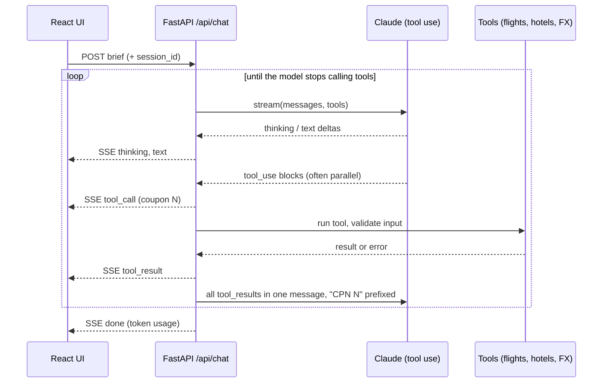

# Safar: an agent copilot for travel agencies

A travel agent pastes a client brief ("2 adults, Istanbul, 5 nights, about $1,500 pp, quote in ETB").
Safar searches flights and hotels, applies the agency's markup, and drafts a client-ready proposal with a
day-by-day plan that prints as a clean client quote.
**Every lookup appears as a numbered coupon** (CPN 01, CPN 02…) beside the answer while it runs, and every price in
the proposal cites its coupon. The agent can check the work before anything reaches a client.

> **Data sources:** flights from [Duffel](https://duffel.com), hotels from [LiteAPI](https://liteapi.travel), airport
> transfers and activities from [Hotelbeds](https://developer.hotelbeds.com), all in sandbox/test mode, so prices are
> realistic but not bookable. Exchange rates are live from the National Bank of Ethiopia
> (via Frankfurter). Without supplier keys, or if a supplier is down, the tools fall back to deterministic demo data,
> and every result is labelled with its source.

<!-- Add screenshots here: desktop.png (completed proposal) and live.png (coupon 04 issuing) -->

## Why it's built this way

AI trip planners already exist. The problem agencies still have is **trust**: a quote with a wrong fare costs
money and a client. Safar treats the agent's reasoning and tool calls as first-class UI rather than hiding them
behind a chat bubble.

| What the role asks for | Where it lives here |
|---|---|
| Full-stack AI apps, Python + modern web framework | FastAPI backend (`app.py`), React 19 frontend (`static/index.html`) |
| Integrate LLMs; agent orchestration; tool integration | Hand-written Claude tool-use loop with parallel tool calls, adaptive thinking, refusal fallbacks |
| Real-time interfaces for AI interaction | Server-Sent Events stream reasoning, tool calls, results and text token by token |
| APIs for AI workflows | `POST /api/chat` streams typed events: `session`, `thinking`, `tool_call`, `tool_result`, `text`, `done`, `error` |
| Reliability and maintainability | History rollback on errors and disconnects, tool-input validation, typed API error handling, tests |
| Prompt engineering | System prompt makes the model cite coupon numbers and write proposal-shaped Markdown |
| Travel industry | Agency workflow: net fares → agency markup → client price, day-by-day itinerary, printable client quote, ADD hub, ETB pricing |

## Plan check: audit the itinerary a client got from ChatGPT

Most advisors now see clients arrive with AI-made plans, and some of those plans name hotels and tours that don't exist
or quote prices that are far off. Paste one in and Safar checks every flight, hotel and activity against the connected
suppliers in parallel. **The verdict is decided in code, not by the model** (`_verdict` in `app.py`):

| Verdict | Meaning |
|---|---|
| verified | Found, and the plan's price is within ±15% of the supplier's |
| price_off | Found, but the price differs by more than 15% (the coupon shows both) |
| name_mismatch | Only a similar name was found (e.g. "Bosphorus Sky Palace" vs the real "Bosphorus Palace"); confirm before using |
| unavailable | Exists at the supplier, but nothing available on those dates |
| not_found | Not found at that supplier. Never reported as "doesn't exist", since a supplier may simply not sell it |
| unchecked | No supplier connected for that item, so nothing is claimed |

Each check is a numbered coupon, the reply opens with a verdict table, and the agent then drafts a corrected,
priced proposal.

## Architecture



**Agent loop (`agent_turn`)**: a manual loop instead of an SDK runner, so every event can be streamed to the UI
as it happens. The details that matter in production:

- **Parallel tool calls**: all results go back in a single user message, which keeps the model calling tools in parallel.
- **Bad tool input is data, not a crash**: wrong or missing arguments become `is_error` tool results the model corrects on its next step.
- **History never corrupts**: if the API errors, the model refuses, output is truncated mid tool call, or the browser disconnects (the Stop button), the half-finished turn is rolled back, so the conversation stays valid.
- **Refusal fallback**: `fallbacks="default"` retries a safety decline on a recommended fallback model server-side.
- **Prompt caching**: top-level `cache_control` caches the system prompt, tools and history across loop iterations.
- **The model never does money math**: `price_quote` turns net USD items into client prices in code. The markup comes from
  the agent's setting on the server and overrides anything the model passes, so the model can't change the agency's margin.
  The client's printed copy drops the CPN citations, net prices and token counts; the agent's screen keeps them.

**Frontend**: one HTML file, React 19 + htm from a CDN, no build step. It parses the SSE stream with `fetch` and a
`ReadableStream`, renders Markdown through DOMPurify, and works from 390px phones up to desktop.

## Editions

One codebase serves two markets. Set `SAFAR_EDITION` in `.env`:

| | `addis` (default) | `internova` |
|---|---|---|
| Agent works for | Travel agencies in Addis Ababa | Advisors at agencies in the US, Canada and the UK |
| Quotes in | ETB (or USD) | USD, CAD or GBP, chosen in the header |
| Exchange rates | National Bank of Ethiopia (live) | Live USD/CAD/GBP rates |
| Sample briefs | Addis → Istanbul, Nairobi, Dubai | Chicago → Lisbon, Toronto → Cancún, Manchester → Rome |
| Plan-check sample | Istanbul plan | Lisbon plan |
| Landing photo | Lalibela highlands | Lisbon tram tracks |

Tools, verdicts, markup and the interface are shared. The edition only changes who the agent serves, the
quoting currency and the samples (`EDITIONS` in `app.py`, `BRIEFS` in `static/index.html`).

## Models

Claude (`claude-opus-5`) by default. Prices, markup, currency and plan-check verdicts are computed in code, so a
different model can change the writing but never a number or a verdict.

**Choose the model in the app:** the model button in the trip desk header opens Settings. Pick a provider and
model there, and paste keys. Keys are saved to `.env` on the server and are never sent back to the browser. Settings
can only be changed from the computer running Safar: requests must come from 127.0.0.1 with a custom header that other
websites can't send, so a hosted demo can't be reconfigured by visitors. Switching between Claude and an
OpenAI-style provider starts a new trip, since the two keep conversation history in different formats.

`.env` still sets the default: `SAFAR_PROVIDER` (anthropic, openrouter, ollama, lmstudio, azure, custom) and `SAFAR_MODEL`.
Claude per-model settings are handled: Haiku gets no thinking parameter; only Opus 5 / Fable 5.1 get server-side
refusal fallbacks.

Providers in Settings (OpenAI-compatible ones need a model that supports tool calling):

| Backend | `OPENAI_BASE_URL` | Notes |
|---|---|---|
| OpenRouter | `https://openrouter.ai/api/v1` | One key, many models; `SAFAR_MODEL` is the model's slug on openrouter.ai |
| Ollama | `http://localhost:11434/v1` | Local and free; e.g. `SAFAR_MODEL=qwen3:8b`; no key needed |
| LM Studio | `http://localhost:1234/v1` | Local; no key needed |
| Azure OpenAI | your resource's `/openai/v1/` endpoint | Verify against your Azure resource's docs |

**Free models** (OpenRouter `:free` models, or any it prices at $0) get a warning in Settings and a reminder under
the message box: their providers may log prompts and train on them, so no real client names, passport details or
itineraries; and they're rate-limited, so keep a paid model ready for demos. OpenRouter models are also checked before
use: one with no live provider that supports tool calling is refused, since the agent can't search without tools.

In OpenAI mode, Claude-only features are off: refusal fallbacks and prompt caching. Reasoning notes appear only if
the provider streams them. Small local models are noticeably weaker at calling tools (they skip checks or call them
one at a time). The coupons still show exactly what each supplier returned.

## Run it

Copy `.env.example` to `.env` and fill in your keys (one `NAME=value` per line). Only `ANTHROPIC_API_KEY` is required;
`DUFFEL_ACCESS_TOKEN`, `LITEAPI_ACCESS_TOKEN` and the `HOTELBEDS_*` key/secret pairs switch flights, hotels, transfers and
activities from demo data to the supplier sandboxes.

```bash
pip install -r requirements.txt
uvicorn app:app --reload
# open http://127.0.0.1:8000 for the landing page, or /app for the trip desk
```

Tests (no API key needed): `python test_app.py`

Hero photos (Unsplash License): Lalibela highlands by [Mulugeta Wolde](https://unsplash.com/photos/hYjIYsJuyVQ); Lisbon tram tracks by [Taton Moïse](https://unsplash.com/photos/9gttcxe3cnM).

## What I'd build next

- **Bookable inventory**: move Duffel and LiteAPI from sandbox to live keys, then add booking (Duffel orders, LiteAPI prebook/book) behind an explicit agent confirmation.
- **More suppliers**: Viator tours; Hotelbeds production keys (the evaluation keys allow 50 requests a day, so results are cached per day).
- **Booking with human approval**: a `hold_booking` tool that pauses the loop for an explicit agent confirmation in the UI.
- **Persistence and scale**: sessions in Redis/Postgres (they live in memory today), auth, per-agency rate limits.
- **Evals**: a fixed set of client briefs, graded on whether every quoted price matches a cited coupon.

---
Built by _your name_ · [LinkedIn](#) · [GitHub](#)
